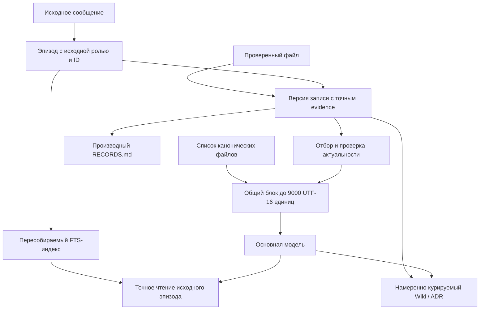

# Как устроена память

[На главную](i18n/README.ru.md) · [Руководство](GUIDE.md)

Память разделяет **оригиналы**, **актуальные версии записей**, **производные представления**
и **контекст текущего запроса**. Выборка или краткий пересказ не повышают полномочия источника.

## 1. Файлы: редактируемые знания и правила

`MEMORY.md` содержит текущие ограничения, `adr/` — решения и их основания, `todo.json` —
задачи, `PROJECT.md` — карту кода и команды. Их поддерживает человек или основной агент.
Документ и статус «accepted» не доказывают каждую фразу: для причин нужна исходная цитата.

Канонический набор — `.memory/MEMORY.md`, `PROJECT.md`, `todo.json`, `architecture.json`
и `.memory/adr/**/*.md`. `/huimem include` добавляет до десяти документов; init включает
`DESIGN.md`, только если создал его сам. В контекст попадает список с размерами, не тела
всех файлов. Generated `RECORDS.md`, Wiki и runtime не включаются как canonical evidence.

## 2. Оригиналы: что действительно было сказано

Включённая project-память сохраняет запросы и текстовые части ответов ассистента в
`.memory/runtime/state.sqlite`. Изображения, рассуждения и полные результаты инструментов
так не архивируются. Ответ интерактивного `ask` сохраняется с ролью user; native subagent
brief и agent-attributed prompt не становятся пользовательским основанием.

Эпизод не превращается в факт автоматически. Поиск возвращает ID/окно, затем
`episodes id=<id> offset=<offset>` раскрывает дословные страницы с `nextOffset`, ролью
и полной длиной оригинала. Цитаты берутся из оригинала, не из добавленных поиском многоточий.

FTS5 в `search.sqlite` — отдельный производный индекс токенов, не вторая стенограмма
и не новая таблица в primary schema. Собственные append индексируются инкрементально;
старый/внешний writer вызывает пересверку. При отказе индекса есть явное degraded-состояние
и полный streaming fallback по оригиналам. Read-only doctor не создаёт индекс.

## 3. Реестр: версии, источники и объяснимый STALE

`project_memory` сохраняет fact, decision, procedure, navigation, task и question.
У каждой записи ID, версия, статус и точный источник. Принятое решение требует user
episode; его rationale — дословный фрагмент source.quote. Assistant inference не проходит
как active/accepted. `source.answers` сохраняет связь короткого ответа с исходным вопросом.

Обновление использует текущий expectedVersion. Конфликт не перезаписывает незнакомое
исправление; прежние версии остаются в history. Это проверка происхождения, не истинности
и не логического следования любой интерпретации из цитаты.

Явные `dependsOn` закрепляют record version или file hash. Их смена/исчезновение/retirement
дают STALE с причиной, в том числе по цепочке. Без dependsOn conversation-backed запись
не устаревает от редактирования документа; файловые факты проверяют свой источник и policy
набор. Новая версия с проверенным текущим основанием снимает STALE; TTL и автоудаления нет.
`links` даёт релевантность, но не доказанную причинность и не зависимость актуальности.

## 4. Производные страницы — не вторая истина

Commit сохраняет версии и желаемый `RECORDS.md` одной SQLite-транзакцией; fsync/rename
публикует читаемый файл. Это восстанавливаемая публикация, не общая FS/SQLite-транзакция.
Конфликт с ручной правкой не перетирается; `/huimem sync` повторяет только публикацию.

`/huimem learn` — явный обычный main-agent turn. Агент может опубликовать Wiki/ADR body
с точными версиями 1–20 свежих подтверждённых записей. Runtime вычисляет fingerprints,
проверяет источник перед публикацией и защищает замену expectedHash/lock.
Смена источника даёт STALE с прежним телом, а не автоматический пересказ.
Страницу нельзя использовать как evidence или для принятия proposed-решения.
Git history доступна по запросу; сообщение коммита не доказывает rationale.

## 5. Доставка и области памяти

По умолчанию scope=project, как в прежних диалогах. Session хранится в отдельной базе под
runtime и следует native ID; personal — отдельно в активном профиле, OFF до человеческого
`/huimem personal on`. Только выбранное оригинальное evidence переносится при scoped commit,
не полная проектная стенограмма. Другие проекты не ищутся неявно.

Перед запросом OMP старый временный блок заменяется новым. Required, meaningful lexical
matches, открытая работа и bounded one-hop bases делят один бюджет. Несвязанное accepted
не закрепляется одним статусом. Sparse IDF не даёт повтору цитаты или старой версии премию;
`Go`/`C#`/`C++` различаются. Явный recall/ID-read раскрывает остальное.

По умолчанию recall budget — 5200, общий injection limit — 9000 UTF-16 единиц, включая
правила, file listing, checkpoints и подписанные scope shares. Это не токены. Целые записи
упаковываются skip-fit, пропущенные/недоступные required ID называются для дочитывания.
Кешируются разобранные версии/токены, не истинность файла по TTL.

## 6. Граница автоматики

| Расширение | Основная модель или человек |
|---|---|
| Сохраняет исходную роль/ID и проверяет цитату | Выбирает значимое и формулирует корректный вывод |
| Проверяет expectedVersion, source и dependsOn | Принимает решение или оставляет его предложением |
| Пересобирает локальный индекс, выбирает bounded context | Дочитывает источник и использует его в ответе |
| Проверяет Wiki provenance, атомарность и stale refs | Намеренно пишет и пересматривает интерпретацию |
| Изолирует scopes и соблюдает явное personal-разрешение | Выбирает scope и разрешает личную память |
| Проверяет настроенные архитектурные строки | Определяет архитектуру и проверяет код инструментами |

Checkpoint — следующий шаг, не Git-коммит и не доказательство выполнения. Отсутствие
checkpoint или нарушение policy даёт предупреждение без forced continuation.
Архитектурная проверка может не пройти при успешно сохранённой памяти.

Идентичные receipts/подтверждённая проекция/неизменный checkpoint не вызывают повторных
SQL-изменений. Реальные изменения сохраняются с WAL/FULL, primary остаётся schema 2.
Плагин не запускает дополнительные модели, MCP, сервер, embeddings или background jobs.
Основная модель и штатная compaction OMP расходуют ресурсы согласно настройкам харнеса.
Измерения и пределы проверок — в [VALIDATION.md](VALIDATION.md).

